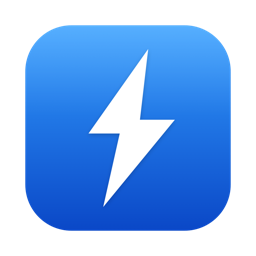
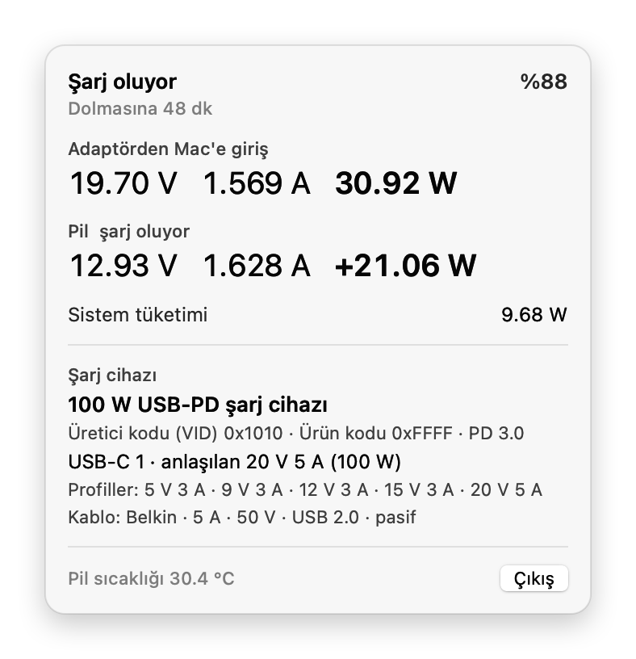
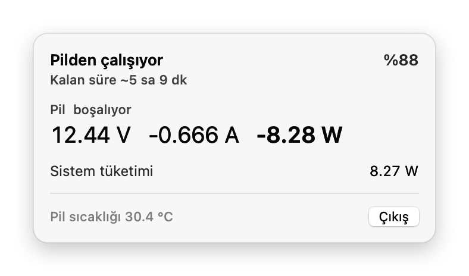
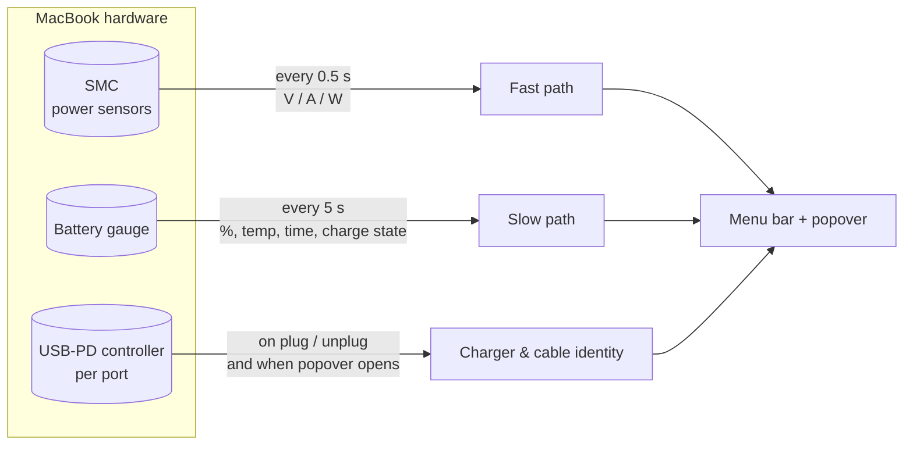

<p align="right"><b>English</b> · <a href="README.tr.md">Türkçe</a></p>

<p align="center">
  
</p>

<h1 align="center">MacWatt</h1>

<p align="center">
  <b>Live volts, amps and watts for your MacBook — right in the menu bar.</b><br>
  See what the charger delivers, what goes into the battery, which charger and cable you plugged in, and why your Mac isn't charging.
</p>

<p align="center">
  
  
  
  
  <a href="LICENSE"></a>
  <a href="https://github.com/dormhi/macwatt/releases"></a>
</p>

<p align="center">
  <picture>
    <source media="(prefers-color-scheme: dark)" srcset="docs/images/popover-charging-dark.png">
    
  </picture>
</p>

> [!NOTE]
> The app's interface is currently in **Turkish**. Screenshots show the Turkish UI; every label is explained below.

---

## Contents

- [Features](#features)
- [Screenshots](#screenshots)
- [Installation](#installation)
- [Opening an unsigned app (Gatekeeper)](#opening-an-unsigned-app-gatekeeper)
- [Usage](#usage)
- [How it works](#how-it-works)
- [Why your Mac isn't charging](#why-your-mac-isnt-charging)
- [Performance](#performance)
- [Limitations](#limitations)
- [Building from source](#building-from-source)
- [License](#license)

---

## Features

| | |
| --- | --- |
| ⚡ **Live power readings** | Charger input, battery and total system power as V / A / W, refreshed every 0.5 s straight from the SMC. |
| 🔌 **Charger identification** | Vendor (from the USB-PD identity), every power profile the charger offers, the one your Mac negotiated, and which port it's on. Apple adapters show up by name — e.g. *Apple 140W USB-C Power Adapter*. |
| 🧵 **Cable details** | For e-marked USB-C cables: vendor, current rating (3 A / 5 A), max voltage (up to 50 V / 240 W EPR) and USB data speed. |
| ⏱️ **Time remaining** | Time to empty on battery, time to full while charging. |
| ❓ **Why it isn't charging** | Battery full, charger too weak, battery too hot, Optimized Battery Charging, or a charge-limiter app (AlDente etc.) holding it back. |
| 🪶 **Tiny footprint** | Text-only menu bar item, ~9 MB RAM, ~0.5 % of one CPU core. No root, no helper, no background daemon. |

## Screenshots

### Menu bar

Text only — no icon taking up space. On the charger it shows the power coming **in**; on battery it shows the power going **out** with a minus sign.

<table>
  <tr>
    <th>On charger</th>
    <th>On battery</th>
  </tr>
  <tr>
    <td>
      <picture>
        <source media="(prefers-color-scheme: dark)" srcset="docs/images/menubar-charging-dark.png">
        
      </picture>
    </td>
    <td>
      <picture>
        <source media="(prefers-color-scheme: dark)" srcset="docs/images/menubar-battery-dark.png">
        
      </picture>
    </td>
  </tr>
</table>

### Popover

Click the menu bar item to open it.

<table>
  <tr>
    <th>Charging</th>
    <th>On battery</th>
  </tr>
  <tr>
    <td valign="top">
      <picture>
        <source media="(prefers-color-scheme: dark)" srcset="docs/images/popover-charging-dark.png">
        
      </picture>
    </td>
    <td valign="top">
      <picture>
        <source media="(prefers-color-scheme: dark)" srcset="docs/images/popover-battery-dark.png">
        
      </picture>
    </td>
  </tr>
</table>

<details>
<summary><b>What the Turkish labels mean</b></summary>

| Turkish | English |
| --- | --- |
| Şarj oluyor | Charging |
| Güç bağlı, şarj olmuyor | Plugged in, not charging |
| Pilden çalışıyor | Running on battery |
| Dolmasına … / Kalan süre ~… | Time to full … / Time remaining ~… |
| Adaptörden Mac'e giriş | Charger → Mac input |
| Pil (şarj oluyor / boşalıyor / beklemede) | Battery (charging / discharging / idle) |
| Sistem tüketimi | System power draw |
| Şarj cihazı | Charger |
| Üretici kodu (VID) · Ürün kodu | Vendor ID · Product ID |
| anlaşılan 20 V 5 A (100 W) | negotiated 20 V 5 A (100 W) |
| Profiller | Power profiles (PDOs) |
| Kablo · pasif / aktif | Cable · passive / active |
| Pil sıcaklığı | Battery temperature |
| Çıkış | Quit |

</details>

## Installation

### Download (recommended)

1. Download **`MacWatt-<version>.dmg`** from the [Releases](https://github.com/dormhi/macwatt/releases) page.
2. Open the DMG and drag **MacWatt** into **Applications**.
3. Open MacWatt from Applications. The first time, macOS will block it — follow the steps in the next section once.

> [!IMPORTANT]
> MacWatt is a free, open-source hobby project and is **not signed with an Apple Developer ID or notarized** (that requires a paid Apple developer account). macOS will therefore warn you the first time you open it. The full source code is in this repository — you can read it, or [build it yourself](#building-from-source) instead.

### Requirements

- macOS 13 Ventura or later
- A MacBook with a battery. Developed and tested on an **Apple Silicon (M2)** MacBook Air. Intel Macs are untested.

## Opening an unsigned app (Gatekeeper)

You only need to do this **once**, after the first launch attempt.

**macOS 15 Sequoia and later**

1. Open MacWatt. macOS shows *"MacWatt" Not Opened* — click **Done**.
2. Open **System Settings → Privacy & Security**.
3. Scroll down to the message about MacWatt and click **Open Anyway**.
4. Confirm with **Open Anyway** and your password / Touch ID.

**macOS 13 Ventura and 14 Sonoma**

1. In Finder, go to **Applications**.
2. **Right-click** (or Control-click) MacWatt → **Open**.
3. Click **Open** in the dialog.

**Terminal alternative (any version)**

Removes the "downloaded from the internet" flag from the app:

```bash
xattr -dr com.apple.quarantine /Applications/MacWatt.app
```

## Usage

- **Click** the menu bar item to open the details popover. Click again (or anywhere else) to close it.
- **Hover** over it for a quick tooltip with all readings.
- **Quit** with the *Çıkış* button at the bottom of the popover.

**Start at login:** add MacWatt in **System Settings → General → Login Items**, or if you installed from source run `./install.sh --autostart`.

**Command line:** print a one-shot reading in the terminal:

```bash
/Applications/MacWatt.app/Contents/MacOS/MacWatt --print
```

```text
Durum:    şarj oluyor (%88)
Dolma:    0 sa 48 dk
Giriş:     19.69 V    1.629 A    32.08 W
Pil:       12.93 V    1.628 A   +21.05 W
Sistem:      9.70 W
Adaptör:  100 W USB-PD şarj cihazı
          Üretici kodu (VID) 0x1010 · Ürün kodu 0xFFFF · PD 3.0
Port:     USB-C 1
    Fixed    5.0-  5.0 V   3.00 A    15.0 W
    Fixed    9.0-  9.0 V   3.00 A    27.0 W
    Fixed   12.0- 12.0 V   3.00 A    36.0 W
    Fixed   15.0- 15.0 V   3.00 A    45.0 W
  * Fixed   20.0- 20.0 V   5.00 A   100.0 W
Kablo:    Belkin · 5 A · 50 V · USB 2.0 · pasif
Sıcaklık: 30.4 °C
```

## How it works

MacWatt reads two hardware sources, both available to a normal user without root:



| What | Where it comes from |
| --- | --- |
| Battery V / A / W | SMC keys `B0AV`, `B0AC`, `B0AP` |
| Charger input V / A / W | SMC keys `VD0R`, `ID0R`, `PDTR` |
| Total system power | SMC key `PSTR` |
| Charge %, temperature, time estimates, charger status codes | IORegistry `AppleSmartBattery` |
| Power profiles (PDOs), negotiated profile, port | IORegistry `IOPortFeaturePowerSource` |
| Charger identity (vendor / product ID, PD revision) | IORegistry `IOPortTransportComponentCCUSBPDSOP` (USB-PD *Discover Identity*, SOP) |
| Cable identity and e-marker data | IORegistry `IOPortTransportComponentCCUSBPDSOPp` (SOP′) |

**Why the SMC?** The values macOS publishes in the battery registry (what most battery apps read) can stay unchanged for tens of seconds — we've seen it still report *not charging* while the battery was already taking in +2.6 A. The SMC sensors update about once a second, so MacWatt polls them every 0.5 s and uses the registry only as a fallback.

**Charger names.** Apple adapters report their own name. Most third-party chargers don't — they only expose a USB-IF vendor ID, which MacWatt maps to a brand for well-known vendors (Apple, Anker, Belkin, Samsung, Google, Xiaomi, Huawei, Lenovo, Dell, HP, Microsoft, ASUS, Sony, LG, …) and otherwise shows as a hex code.

## Why your Mac isn't charging

When the charger is connected but the battery isn't taking power, MacWatt shows the most likely reason in orange under the status line. The checks run in this order:

| Shown reason | What it means |
| --- | --- |
| Charging stopped by an app (AlDente, battery, …) | The SMC's charge-inhibit flag is set by a charge-limiter tool. |
| Adapter disabled — Mac running on battery | The SMC has been told to ignore the charger. |
| Battery full | The battery reports fully charged / 100 %. |
| System inhibited charging (code …) | macOS' charger reports an inhibit code. |
| Charger too weak: input X W, load Y W | The Mac uses more power than the charger delivers, so it drains the battery. |
| Battery hot (… °C) | Charging pauses until the battery cools down. |
| Probably Optimized Battery Charging (holding at 80 %) | Charge is ≥ 75 % with no other cause found. |
| No power from the charger | Connected, but almost nothing coming in. |

> [!NOTE]
> Apple doesn't document its internal "not charging" codes, so these reasons are inferred from measurements. *Optimized Battery Charging* in particular is a best guess.

## Performance

MacWatt is designed to stay out of the way:

| | |
| --- | --- |
| Memory | **~9 MB** |
| CPU | **~0.5 %** of one core (≈ 0.27 s of CPU per minute) |
| Memory leaks | none (`leaks` reports 0 bytes) |
| Download size | ~370 KB DMG |

How: only the 12 battery-registry keys it needs are read (not the large full dictionary), the USB-PD port tree is scanned only when you plug or unplug something or open the popover, and the popover isn't laid out while it's closed.

## Limitations

- **Unsigned build** — see [Gatekeeper](#opening-an-unsigned-app-gatekeeper) above.
- **Undocumented interfaces.** SMC keys aren't documented by Apple and may change between macOS versions or Mac models. If they can't be read, MacWatt falls back to the (slower) registry values.
- **Third-party charger names.** Only the vendor can be identified, and only if it's in MacWatt's table. Whether a charger is GaN can't be detected — macOS doesn't expose it.
- **Not on the Mac App Store.** Reading the SMC isn't allowed in sandboxed App Store apps.
- **Turkish UI** for now.

## Building from source

Requires the Xcode Command Line Tools (`xcode-select --install`). No Xcode project, no dependencies.

```bash
git clone https://github.com/dormhi/macwatt.git
cd macwatt
./install.sh
```

| Command | What it does |
| --- | --- |
| `./build.sh` | Build only → `build/MacWatt.app` |
| `./install.sh` | Build, copy to `/Applications`, launch |
| `./install.sh --autostart` | …and start automatically at login |
| `./install.sh --autostart-off` | Turn off start at login |
| `./install.sh --uninstall` | Remove the app and the login item |
| `./package.sh` | Build the release DMG → `dist/MacWatt-<version>.dmg` |

Apps you build yourself aren't quarantined, so no Gatekeeper steps are needed.

**Project layout**

```text
Sources/MacWatt/
  main.m          app delegate, menu bar item, refresh timer, --print
  PowerReader.*   battery registry, charger/cable identity, not-charging reasons
  SMC.*           minimal AppleSMC key reader
  PowerView.*     popover UI
Tools/makeicon.m  generates the app icon
```

## License

[MIT](LICENSE) © 2026 Davut can cüci
