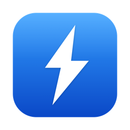
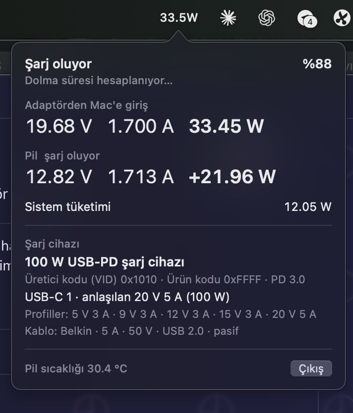
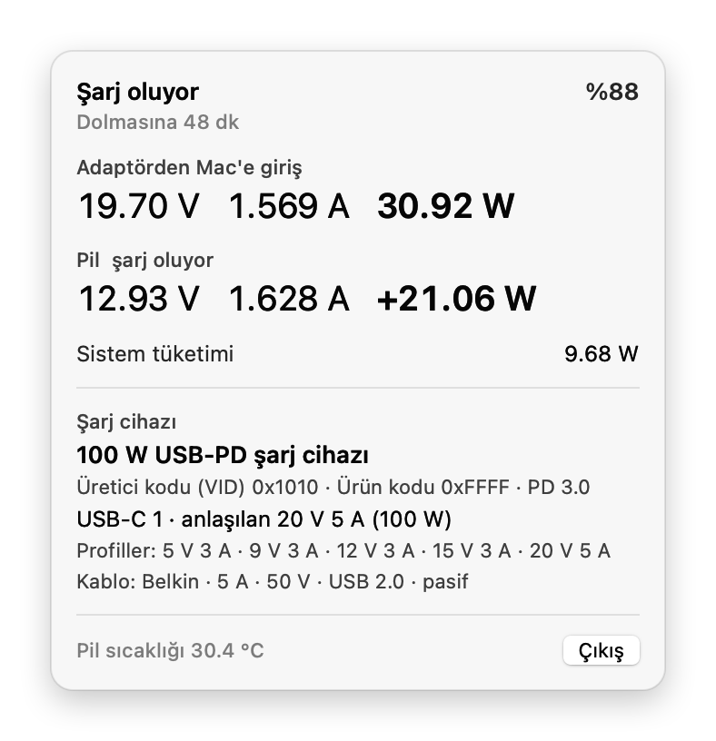
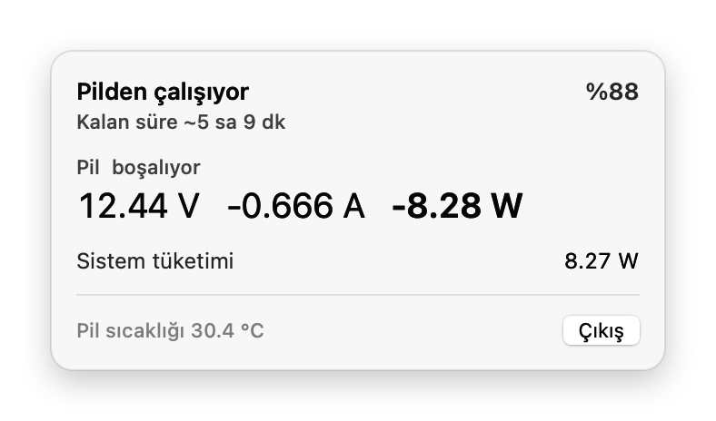
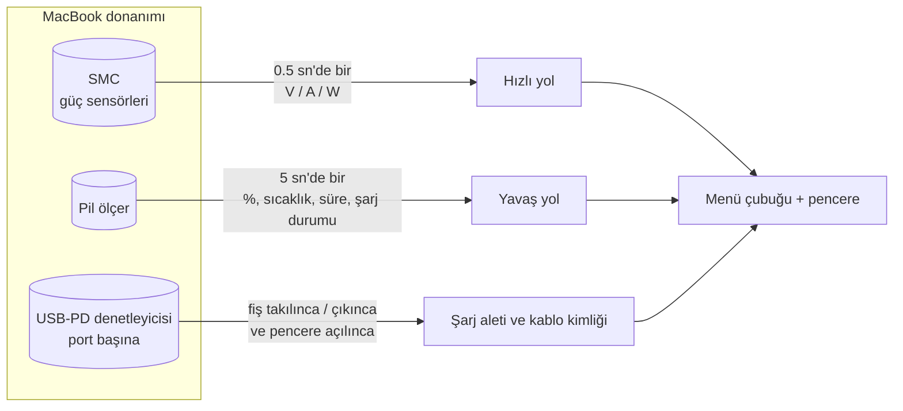

<p align="right"><a href="README.md">English</a> · <b>Türkçe</b></p>

<p align="center">
  
</p>

<h1 align="center">MacWatt</h1>

<p align="center">
  <b>MacBook'unuz için canlı volt, amper ve watt — doğrudan menü çubuğunda.</b><br>
  Şarj aletinin ne verdiğini, pile ne girdiğini, hangi şarj aleti ve kabloyu taktığınızı ve Mac'in neden şarj olmadığını görün.
</p>

<p align="center">
  
  
  
  
  <a href="LICENSE"></a>
  <a href="https://github.com/dormhi/macwatt/releases"></a>
</p>

<p align="center">
  
</p>

---

## İçindekiler

- [Özellikler](#özellikler)
- [Ekran görüntüleri](#ekran-görüntüleri)
- [Kurulum](#kurulum)
- [Gatekeeper: imzasız uygulamayı açmak](#gatekeeper-imzasız-uygulamayı-açmak)
- [Kullanım](#kullanım)
- [Nasıl çalışır](#nasıl-çalışır)
- [Mac neden şarj olmuyor](#mac-neden-şarj-olmuyor)
- [Performans](#performans)
- [Sınırlamalar](#sınırlamalar)
- [Kaynaktan derleme](#kaynaktan-derleme)
- [Lisans](#lisans)

---

## Özellikler

| | |
| --- | --- |
| ⚡ **Canlı güç ölçümü** | Adaptör girişi, pil ve toplam sistem tüketimi V / A / W olarak; doğrudan SMC'den, 0.5 sn'de bir. |
| 🔌 **Şarj aleti tanıma** | USB-PD kimliğinden üretici, şarj aletinin sunduğu tüm güç profilleri, Mac'in seçtiği profil ve bağlı port. Apple adaptörleri adıyla görünür — örn. *Apple 140W USB-C Power Adapter*. |
| 🧵 **Kablo bilgisi** | E-marker'lı USB-C kablolarda üretici, akım kapasitesi (3 A / 5 A), maksimum voltaj (50 V / 240 W EPR'ye kadar) ve USB veri hızı. |
| ⏱️ **Kalan süre** | Pildeyken boşalmaya, şarjdayken dolmaya kalan süre. |
| ❓ **Neden şarj olmuyor** | Pil dolu, adaptör yetersiz, pil sıcak, Optimize Pil Şarjı ya da şarjı durduran bir uygulama (AlDente vb.). |
| 🪶 **Hafif** | Menü çubuğunda sadece metin, ~9 MB bellek, tek çekirdeğin ~%0.5'i. Root, yardımcı servis veya arka plan süreci yok. |

## Ekran görüntüleri

### Menü çubuğu

Yer kaplayan simge yok, sadece metin. Adaptördeyken Mac'e **giren** gücü, pildeyken eksi işaretiyle **harcanan** gücü gösterir.

<table>
  <tr>
    <th>Adaptörde</th>
    <th>Pilde</th>
  </tr>
  <tr>
    <td>
      <picture>
        <source media="(prefers-color-scheme: dark)" srcset="docs/images/menubar-charging-dark.png">
        
      </picture>
    </td>
    <td>
      <picture>
        <source media="(prefers-color-scheme: dark)" srcset="docs/images/menubar-battery-dark.png">
        
      </picture>
    </td>
  </tr>
</table>

### Ayrıntı penceresi

Menü çubuğundaki yazıya tıklayınca açılır.

<table>
  <tr>
    <th>Şarj olurken</th>
    <th>Pilde</th>
  </tr>
  <tr>
    <td valign="top">
      <picture>
        <source media="(prefers-color-scheme: dark)" srcset="docs/images/popover-charging-dark.png">
        
      </picture>
    </td>
    <td valign="top">
      <picture>
        <source media="(prefers-color-scheme: dark)" srcset="docs/images/popover-battery-dark.png">
        
      </picture>
    </td>
  </tr>
</table>

## Kurulum

### İndirerek (önerilen)

1. [Releases](https://github.com/dormhi/macwatt/releases) sayfasından **`MacWatt-<sürüm>.dmg`** dosyasını indirin.
2. DMG'yi açın, **MacWatt**'ı **Applications** (Uygulamalar) klasörüne sürükleyin.
3. MacWatt'ı Uygulamalar'dan açın. İlk seferde macOS engelleyecek — bir sonraki bölümdeki adımları bir kez uygulayın.

> [!IMPORTANT]
> MacWatt ücretsiz, açık kaynak bir hobi projesidir ve **Apple Developer ID ile imzalanmamış, Apple onayından (notarization) geçmemiştir** — bunun için ücretli Apple geliştirici hesabı gerekir. Bu yüzden macOS ilk açılışta uyarı verir. Kaynak kodun tamamı bu depoda; isterseniz inceleyebilir ya da [kendiniz derleyebilirsiniz](#kaynaktan-derleme).

### Gereksinimler

- macOS 13 Ventura veya üstü
- Pilli bir MacBook. **Apple Silicon (M2)** MacBook Air üzerinde geliştirildi ve test edildi. Intel Mac'lerde denenmedi.

## Gatekeeper: imzasız uygulamayı açmak

Bunu ilk açma denemesinden sonra **yalnızca bir kez** yapmanız gerekir.

**macOS 15 Sequoia ve sonrası**

1. MacWatt'ı açın. macOS *"MacWatt" açılmadı* der — **Bitti**'ye basın.
2. **Sistem Ayarları → Gizlilik ve Güvenlik**'i açın.
3. Aşağıdaki MacWatt uyarısını bulup **Yine de Aç**'a basın.
4. **Yine de Aç** ve parolanız / Touch ID ile onaylayın.

**macOS 13 Ventura ve 14 Sonoma**

1. Finder'da **Uygulamalar** klasörüne gidin.
2. MacWatt'a **sağ tıklayın** (veya Control-tık) → **Aç**.
3. Açılan pencerede **Aç**'a basın.

**Terminal yolu (her sürümde)**

Uygulamadaki "internetten indirildi" işaretini kaldırır:

```bash
xattr -dr com.apple.quarantine /Applications/MacWatt.app
```

## Kullanım

- Menü çubuğundaki yazıya **tıklayın**: ayrıntı penceresi açılır. Tekrar tıklayınca (ya da başka bir yere) kapanır.
- Üzerinde **bekletin**: tüm değerleri gösteren kısa bir ipucu çıkar.
- Pencerenin altındaki **Çıkış** düğmesiyle kapatın.

**Açılışta başlatma:** **Sistem Ayarları → Genel → Giriş Öğeleri**'ne MacWatt'ı ekleyin; kaynaktan kurduysanız `./install.sh --autostart` çalıştırın.

**Komut satırı:** terminalde tek seferlik okuma:

```bash
/Applications/MacWatt.app/Contents/MacOS/MacWatt --print
```

## Nasıl çalışır

MacWatt iki donanım kaynağını okur; ikisi de root gerektirmez:



| Veri | Kaynak |
| --- | --- |
| Pil V / A / W | SMC `B0AV`, `B0AC`, `B0AP` |
| Adaptör girişi V / A / W | SMC `VD0R`, `ID0R`, `PDTR` |
| Toplam sistem tüketimi | SMC `PSTR` |
| Yüzde, sıcaklık, süre tahminleri, şarj durum kodları | IORegistry `AppleSmartBattery` |
| Güç profilleri (PDO), seçilen profil, port | IORegistry `IOPortFeaturePowerSource` |
| Şarj aleti kimliği (üretici / ürün kodu, PD sürümü) | IORegistry `IOPortTransportComponentCCUSBPDSOP` (USB-PD *Discover Identity*, SOP) |
| Kablo kimliği ve e-marker verisi | IORegistry `IOPortTransportComponentCCUSBPDSOPp` (SOP′) |

**Neden SMC?** macOS'un pil kaydında yayımladığı değerler (çoğu pil uygulamasının okuduğu) onlarca saniye değişmeden kalabiliyor — pil +2.6 A çekerken hâlâ *şarj olmuyor* dediğini gördük. SMC sensörleri saniyede bir güncellenir; MacWatt onları 0.5 sn'de bir okur ve pil kaydını sadece yedek olarak kullanır.

**Şarj aleti adları.** Apple adaptörleri adını kendisi bildirir. Çoğu üçüncü parti şarj aleti bildirmez; yalnızca USB-IF üretici kodunu (VID) verir. MacWatt bilinen markalar için (Apple, Anker, Belkin, Samsung, Google, Xiaomi, Huawei, Lenovo, Dell, HP, Microsoft, ASUS, Sony, LG, …) bunu isme çevirir, diğerlerini kod olarak gösterir.

## Mac neden şarj olmuyor

Adaptör bağlı ama pil güç almıyorsa, MacWatt en olası nedeni durum satırının altında turuncu yazar. Kontroller bu sırayla yapılır:

| Gösterilen neden | Anlamı |
| --- | --- |
| Şarj bir uygulama tarafından durduruldu (AlDente, battery vb.) | Bir şarj sınırlayıcı araç SMC'deki şarj engelleme bayrağını açmış. |
| Adaptör devre dışı — Mac pilden besleniyor | SMC'ye adaptörü yok sayması söylenmiş. |
| Pil dolu | Pil tam dolu / %100. |
| Sistem şarjı engelledi (kod …) | macOS'un şarj denetleyicisi bir engelleme kodu bildiriyor. |
| Adaptör yetmiyor: giriş X W, tüketim Y W | Mac adaptörün verdiğinden fazla güç harcıyor, pili tüketiyor. |
| Pil sıcak (… °C) | Pil soğuyana kadar şarj duraklar. |
| Büyük olasılıkla Optimize Pil Şarjı (%80'de bekletiyor) | Şarj ≥ %75 ve başka neden bulunamadı. |
| Adaptörden güç gelmiyor | Bağlı ama neredeyse hiç güç gelmiyor. |

> [!NOTE]
> Apple iç "şarj olmuyor" kodlarını belgelemiyor; bu nedenler ölçümlerden çıkarılır. Özellikle *Optimize Pil Şarjı* bir tahmindir.

## Performans

| | |
| --- | --- |
| Bellek | **~9 MB** |
| İşlemci | tek çekirdeğin **~%0.5**'i (dakikada ≈ 0.27 sn işlemci zamanı) |
| Bellek sızıntısı | yok (`leaks` 0 bayt raporluyor) |
| İndirme boyutu | ~370 KB DMG |

Nasıl: pil kaydının büyük sözlüğünün tamamı yerine yalnızca gereken 12 anahtar okunur; USB-PD port ağacı sadece fiş takılıp çıkarıldığında ya da pencere açıldığında taranır; pencere kapalıyken arayüz yeniden çizilmez.

## Sınırlamalar

- **İmzasız** — yukarıdaki [Gatekeeper](#gatekeeper-imzasız-uygulamayı-açmak) adımlarına bakın.
- **Belgelenmemiş arayüzler.** SMC anahtarları Apple tarafından belgelenmez; macOS sürümleri ya da Mac modelleri arasında değişebilir. Okunamazlarsa MacWatt (daha yavaş) pil kaydı değerlerine döner.
- **Üçüncü parti şarj aleti adları.** Yalnızca üretici bulunabilir, o da MacWatt'ın tablosundaysa. Şarj aletinin GaN olup olmadığı tespit edilemez — macOS bu bilgiyi vermiyor.
- **Mac App Store'da yok.** App Store'un korumalı (sandbox) uygulamalarında SMC okumaya izin verilmiyor.

## Kaynaktan derleme

Xcode Command Line Tools gerekir (`xcode-select --install`). Xcode projesi ya da bağımlılık yok.

```bash
git clone https://github.com/dormhi/macwatt.git
cd macwatt
./install.sh
```

| Komut | Ne yapar |
| --- | --- |
| `./build.sh` | Yalnızca derler → `build/MacWatt.app` |
| `./install.sh` | Derler, `/Applications`'a kopyalar, başlatır |
| `./install.sh --autostart` | …ayrıca oturum açılışında başlatır |
| `./install.sh --autostart-off` | Açılışta başlatmayı kapatır |
| `./install.sh --uninstall` | Uygulamayı ve giriş öğesini kaldırır |
| `./package.sh` | Dağıtım DMG'sini üretir → `dist/MacWatt-<sürüm>.dmg` |

Kendi derlediğiniz uygulama karantinaya alınmaz; Gatekeeper adımlarına gerek yoktur.

## Lisans

[MIT](LICENSE) © 2026 Davut can cüci
